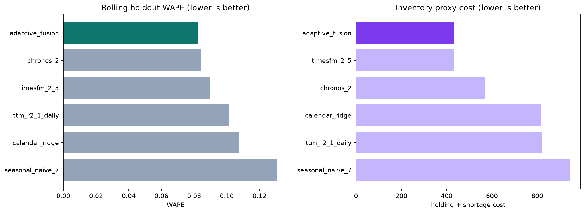
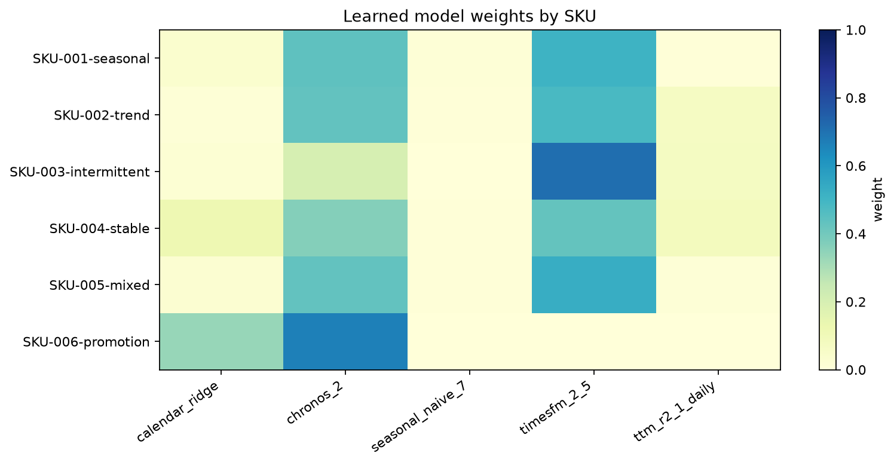

# Inventory Fusion Commercial v1

**A commercially usable, auditable mixture-of-experts system for probabilistic demand forecasting and constrained inventory replenishment.**

This repository connects three Apache-2.0 Hugging Face time-series foundation models—IBM Granite TinyTimeMixer R2.1, Amazon Chronos-2, and Google TimesFM 2.5—with five lightweight statistical baselines, a hierarchical adaptive fusion layer, and an optional OR-Tools inventory optimizer. It is intended as a strong, modifiable starting point for enterprise inventory projects.

> **Important:** this is a composite forecasting system, not a tensor-level weight merge. The three foundation models use different architectures and cannot be safely averaged at the parameter level. Their forecasts are combined by a learned, per-SKU/per-segment mixture-of-experts layer. Official base weights are downloaded from their original repositories at immutable revisions; they are not duplicated here.

## Why this design

An inventory decision is not just a language-model response. It is a chain of distinct problems:

```text
sales + stockouts + price + promotions + calendar + lead time
                           |
                           v
        TTM + Chronos-2 + TimesFM + statistical baselines
                           |
                           v
     hierarchical adaptive fusion (global -> segment -> SKU)
                           |
                           v
             calibrated P10 / P50 / P90 demand
                           |
                           v
 OR-Tools replenishment: MOQ, case pack, budget, capacity, service level
                           |
                           v
      proposed order quantity + evidence + human approval
```

The forecasting layer estimates demand and uncertainty. The optimizer applies business constraints. Keeping those responsibilities separate makes the system testable, auditable, and much safer to modify.

## Included experts

| Expert | Immutable revision | License | Role |
|---|---|---|---|
| `ibm-granite/granite-timeseries-ttm-r2` | `caa1eb3d16f053859d81952a1f387d6aeb670076` | Apache-2.0 | Compact daily point forecaster with residual quantile calibration |
| `amazon/chronos-2` | `29ec3766d36d6f73f0696f85560a422f50e8498c` | Apache-2.0 | Native probabilistic forecasting and known-future covariates |
| `google/timesfm-2.5-200m-pytorch` | `1d952420fba87f3c6dee4f240de0f1a0fbc790e3` | Apache-2.0 | Long-context point and continuous-quantile challenger |
| Seasonal naive, moving average, linear trend, Croston, calendar ridge | repository source | Apache-2.0 | Robust fallbacks, intermittent-demand coverage, and explainable baselines |

`configs/model_registry.json` is an executable license gate. It allows only approved permissive licenses and requires immutable revisions. For example, Salesforce Moirai 2 is recorded but blocked because its CC BY-NC license is not suitable for unrestricted commercial deployment.

## How adaptive fusion works

The fusion layer does more than take a simple average:

1. Every expert is evaluated on rolling historical windows using normalized quantile loss.
2. Evidence is pooled at three levels: global portfolio, demand segment, and individual SKU.
3. Segment estimates shrink toward global evidence; SKU estimates shrink toward segment evidence. This prevents a new or sparse SKU from overfitting a handful of windows.
4. Relative losses are converted to exponential weights with a configurable temperature.
5. A maximum expert weight of 0.88 prevents accidental single-model collapse.
6. If an expert is unavailable, its weight is removed and the remaining weights are renormalized.
7. After actual demand arrives, `online_update()` can adapt weights without retraining the foundation models.
8. The learned state is serializable JSON, so every production forecast can be traced to its exact expert weights.

The included validation state learned these global weights:

| Expert | Global weight |
|---|---:|
| TimesFM 2.5 | 53.26% |
| Chronos-2 | 36.51% |
| TTM R2.1 | 5.83% |
| Calendar ridge | 4.40% |
| Seasonal naive | 0.004% |

Those values are **examples learned from the included synthetic workload**, not universal production defaults. Refit the fusion layer on your own temporally separated backtest.

## Evidence from the included evaluation

The packaged evidence was produced with the real pinned Hugging Face checkpoints on an NVIDIA RTX 3070 Ti 8 GB. It used 54 tuning windows, 36 later holdout windows, six deliberately different demand patterns, and 504 holdout observations. The holdout was not used to learn weights.

### Aggregate forecasting results

| Model | WAPE ↓ | Bias | RMSE ↓ | Pinball loss ↓ | P90 coverage |
|---|---:|---:|---:|---:|---:|
| **Adaptive fusion** | **0.0826** | -0.0321 | 7.3866 | 0.1058 | 0.9147 |
| Chronos-2 | 0.0841 | -0.0275 | **7.3722** | 0.1259 | 0.9087 |
| TimesFM 2.5 | 0.0895 | -0.0403 | 7.5630 | **0.1030** | 0.9127 |
| TTM R2.1 | 0.1012 | -0.0552 | 7.7082 | 0.1369 | 0.9048 |
| Calendar ridge | 0.1072 | -0.0554 | 7.6232 | 0.1442 | 0.7956 |
| Seasonal naive | 0.1308 | -0.0071 | 8.8323 | 0.2451 | 0.9246 |

On this workload, adaptive fusion reduced WAPE by **1.76% relative to the best single expert**, Chronos-2, while keeping P90 coverage close to the nominal 90% target. This is a modest but measurable gain; the repository intentionally reports it without exaggeration.






### Inventory-policy proxy

The same P90 forecasts were converted into a simplified order-up-to policy. The proxy penalizes leftover stock and shortages; it is useful for comparing models under the same assumptions, but it is not a production ROI claim.

| Model | Fill rate ↑ | Average leftover ↓ | Proxy total cost ↓ | Shortage units ↓ |
|---|---:|---:|---:|---:|
| **Adaptive fusion** | **1.0000** | **60.0042** | **432.0303** | **0.0000** |
| TimesFM 2.5 | 1.0000 | 60.1341 | 432.9656 | 0.0000 |
| Chronos-2 | 1.0000 | 79.1390 | 569.8010 | 0.0000 |
| Calendar ridge | 0.9965 | 82.3650 | 816.3986 | 44.6742 |
| TTM R2.1 | 1.0000 | 113.9124 | 820.1693 | 0.0000 |
| Seasonal naive | 1.0000 | 131.0522 | 943.5760 | 0.0000 |

All raw metrics, per-SKU results, learned weights, plots, and the serialized fusion state are in `evaluation/`.

## Installation

Python 3.11 or newer is required. A CUDA PyTorch build is strongly recommended for the three foundation models.

```bash
git clone https://huggingface.co/NeoZJX/inventory-fusion-commercial-v1
cd inventory-fusion-commercial-v1

python -m venv .venv
# Windows: .venv\Scripts\activate
# Linux/macOS: source .venv/bin/activate

pip install -e ".[all-models,optimize]"
python scripts/download_models.py
```

The downloader checks the commercial-use gate and fetches the exact pinned revisions into `models/`. Public downloads do not require a Hugging Face token.

To install only the lightweight baselines:

```bash
pip install -e .
inventory-fusion demo --output outputs/demo
```

## Quick validation with all three foundation models

```bash
inventory-fusion hf-smoke \
  --output outputs/hf-smoke \
  --skus 3 \
  --days 336 \
  --horizon 14
```

This command generates the same artifact types used in this model card: CSV metrics, fusion weights, JSON state, a Markdown summary, and PNG evidence charts.

## Backtest your own data

Prepare a daily CSV as documented in `DATA_CONTRACT.md`, then run:

```bash
inventory-fusion backtest \
  --data data/inventory_daily.csv \
  --output outputs/company-backtest \
  --horizon 14 \
  --min-train 180 \
  --step 14
```

The default `backtest` command intentionally starts with lightweight experts, so it is fast enough for data-quality iteration. Use the Python API or adapt `hf-smoke` when you are ready to include all three foundation models in a longer enterprise backtest.

## Python API: fusion and online learning

```python
from inventory_fusion.fusion import AdaptiveFusion

fusion = AdaptiveFusion(
    temperature=7.0,
    sku_shrinkage=4.0,
    segment_shrinkage=8.0,
    max_weight=0.88,
).fit(tuning_records)

forecast = fusion.blend(
    sku="SKU-1042",
    segment="promotion_driven",
    forecasts=expert_forecasts,
)

print(forecast.quantile(0.5))
print(forecast.quantile(0.9))
print(forecast.metadata["weights"])

fusion.online_update(realized_record, learning_rate=0.25)
fusion.save("artifacts/fusion_state.json")
```

## Chronos-2 LoRA adaptation

The Chronos adapter exposes `Chronos2Forecaster.fit_lora(...)`. This is the recommended first adaptation route on an 8 GB GPU because it updates a small number of parameters while preserving the official base checkpoint. Use a chronological training/validation split, log every experiment, and compare against the unadapted expert and the full fusion system. Never select a LoRA checkpoint on the final holdout period.

Fine-tuning is optional. The fusion layer often captures useful portfolio-specific behavior before expensive training is justified.

## Inventory optimization

The included OR-Tools layer is designed to consume probabilistic forecasts and convert them into constrained replenishment decisions. It supports the core structure needed for:

- inventory position: on-hand + confirmed inbound - allocations - backorders;
- protection period: review interval + supplier lead time;
- target service quantile, such as P90;
- MOQ and case-pack rounding;
- purchase budget and warehouse capacity;
- holding, shortage, purchase, and fixed-order costs.

Production deployments should add their own shelf-life, supplier-capacity, inbound-labor, pallet, transportation, and multi-echelon constraints. Proposed orders should remain subject to human approval until a shadow run demonstrates stable performance.

## Data and leakage requirements

The largest practical risk is confusing observed sales with unconstrained demand. A zero sale during a stockout does not imply zero customer demand. Preserve order quantity, lost sales, backorders, inventory availability, and a stockout/censoring flag wherever possible.

Known-future covariates may include an approved promotion schedule, price plan, holiday calendar, or committed event plan. Do not expose revisions that became known only after the forecast origin. See `DATA_CONTRACT.md` for the canonical schema and leakage rules.

## Reproducibility and auditability

- Every external model is pinned to a full immutable commit hash.
- The commercial-license gate is checked before multi-model execution or download.
- Tune and holdout windows are separated chronologically.
- Fusion weights are stored as plain JSON rather than hidden in an opaque service.
- Exact per-SKU metrics and raw evaluation tables are included.
- Baselines remain available when a foundation model is unavailable or regresses.
- Source code and tests are part of this public artifact.

## Commercial use and modification

The original code in this repository is released under Apache License 2.0. The three referenced base-model repositories declare Apache-2.0 licenses at the pinned revisions, allowing commercial use and modification subject to the license terms. Keep the applicable copyright, license, attribution, and NOTICE materials when redistributing this repository or derivative artifacts.

This repository does not relicense third-party weights, dependencies, datasets, trademarks, or documentation. Review `THIRD_PARTY_NOTICES.md` and the upstream repositories before distribution. License compatibility is a technical release safeguard here, not legal advice.

## Limitations

- The published validation uses synthetic demand patterns. It proves that the pipeline runs end to end and that its gain is visible on this workload; it does **not** prove savings on a specific company's data.
- Intermittent demand remains difficult. Stockout-censored demand and very sparse series need explicit treatment.
- TTM is converted from a point forecast to quantiles using empirical residual calibration; validate interval calibration on your own data.
- Foundation models can regress on particular segments. The ensemble and baselines reduce this risk but do not eliminate it.
- Supplier lead times, costs, promotions, and inventory records can be wrong or delayed. Data-quality monitoring is mandatory.
- The package does not autonomously submit purchase orders, modify ERP records, or guarantee service levels or financial outcomes.
- Demand shocks outside the historical support may require overrides, scenario forecasts, and planner review.

## Recommended production acceptance test

1. Backtest at least 8–12 fully sealed recent weeks.
2. Report WAPE, bias, pinball loss, P90 coverage, fill rate, average inventory value, expiry, and total inventory cost by SKU segment.
3. Compare against the current business policy and every single expert—not just a weak baseline.
4. Run 4–8 weeks in shadow mode with planner approval.
5. Promote only if the system improves cost at equal service, or service at equal working capital, without increasing constraint violations.

## Repository map

```text
configs/model_registry.json  pinned models and commercial-license gate
evaluation/                 raw holdout metrics, plots, and learned state
scripts/download_models.py  reproducible base-model downloader
src/inventory_fusion/       forecasting, fusion, reporting, and optimization code
tests/                      unit tests for fusion, backtesting, registry, and optimizer
DATA_CONTRACT.md             enterprise input schema and leakage controls
THIRD_PARTY_NOTICES.md       upstream licenses, revisions, and attribution
```

## Citation

```bibtex
@software{inventory_fusion_commercial_v1,
  author = {NeoZJX},
  title = {Inventory Fusion Commercial v1},
  year = {2026},
  url = {https://huggingface.co/NeoZJX/inventory-fusion-commercial-v1},
  license = {Apache-2.0}
}
```

Please also cite IBM Granite TinyTimeMixer, Amazon Chronos-2, and Google TimesFM when their models are used in your deployment or research.
